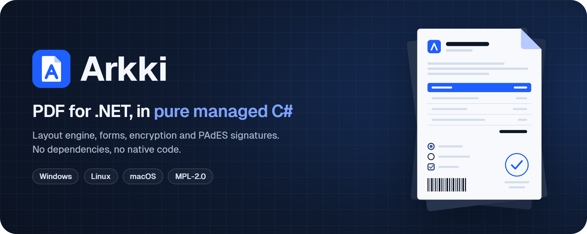

# Arkki

[](https://geezery.github.io/arkki/)

[](https://github.com/geezery/arkki/actions/workflows/ci.yml)
[](https://www.nuget.org/packages/Arkki.Pdf)
[](https://github.com/geezery/arkki/blob/main/LICENSE)

PDF for .NET, written in C#: create documents with a paginating layout engine, open and edit existing
files, fill and create forms, encrypt, and sign. Pure managed code that runs the same on Windows, Linux and
macOS: no System.Drawing, no native binaries, no browser engine. The core package has no dependencies;
signing adds only Microsoft's `System.Security.Cryptography.Pkcs`. Licensed under the Mozilla Public
License 2.0.

| Package | Contents |
|---|---|
| `Arkki.Pdf` | Writer, layout engine, TrueType/OpenType fonts, PNG/JPEG images, barcodes, reader, merging, page operations, stamping, forms, links, bookmarks, attachments, encryption |
| `Arkki.Pdf.Signing` | PAdES digital signatures from B-B to B-LTA: invisible and visible, with a local or an external key, RFC 3161 timestamps, long-term validation data, and verification with revocation checking |

Requires .NET 10.

```
dotnet add package Arkki.Pdf --prerelease
dotnet add package Arkki.Pdf.Signing --prerelease   # only for digital signatures
```

[Homepage](https://geezery.github.io/arkki/) · [Wiki](https://github.com/geezery/arkki/wiki) ·
[Changelog](https://github.com/geezery/arkki/blob/main/CHANGELOG.md) · [Contributing](https://github.com/geezery/arkki/blob/main/CONTRIBUTING.md) · [Security](https://github.com/geezery/arkki/blob/main/SECURITY.md)

## Create a document

A document is a tree of layout elements that flows onto as many pages as it needs:

```csharp
using Arkki.Pdf;
using Arkki.Pdf.Barcodes;
using Arkki.Pdf.Layout;
using Arkki.Pdf.Reading;

var doc = new PdfDocument();
doc.Info.Title = "Order 1187";
var fonts = new FontFamily(doc.AddFont(File.ReadAllBytes("Inter-Regular.ttf")),
                           doc.AddFont(File.ReadAllBytes("Inter-Bold.ttf")));
var body = new TextStyle(fonts, 10);

var table = new Table([new TableColumn(Len.Star()), new TableColumn(Len.Mm(30), HAlign.Right)])
    .SetHeader(body with { Bold = true }, "Item", "Amount");
table.AddRow(body, "Machining", "258,00");

new FlowDocument
{
    PageWidth = PageSize.A4.Width, PageHeight = PageSize.A4.Height,   // A4 is the default
    Header = page => new TextBlock($"Page {page.PageNumber} ({page.PageCount})", body, HAlign.Right),
    Content = new Column(
        new TextBlock("Order 1187", body with { Size = 18, Bold = true }),
        new TextBlock("Long terms of delivery that wrap and are justified …", body, HAlign.Justify),
        new ListBlock(body, ListMarker.Number).Add("Check the parts").Add("Book the time"),
        table) { Spacing = 8 },
}.RenderTo(doc);

using var file = File.Create("order.pdf");
doc.Save(file);              // or doc.ToArray()
```

Text and layout:

- Paragraphs mix styles: `new TextBlock([new("Due ", body), new("7.12.2026", body with { Bold = true })])`.
- Left, right, centred and justified text. Soft hyphens (U+00AD) and a compound's own hyphen are break points;
  plug in language rules with `IHyphenator` (no dictionaries ship with Arkki).
- Bulleted, numbered and lettered lists with hanging indents and nesting (`ListBlock`).
- Tables with headers repeated on each page, column spans, cell fills and borders, row styles.
- `Row`, `Column`, `Box`, padding, `KeepTogether`, `KeepWithNext`, `PageBreak`, images and barcodes in the flow.
- Italic needs its own font file: `new FontFamily(regular, bold, Italic: italic, BoldItalic: boldItalic)`.

Paper sizes: `PageSize.A0`–`A7`, `B4`, `B5`, `C4`–`C6`, `DL`, `Letter`, `Legal`, `Tabloid`, `Executive`,
`PageSize.Landscape(PageSize.A4)`, or any size with `PageSize.Mm(w, h)`.

The canvas draws directly when you need exact positions:

```csharp
PdfPage page = doc.AddPage(PageSize.A4);
page.Canvas.Text(font, 12, Unit.Mm(20), Unit.Mm(30), "Exactly here");
page.Canvas.Barcode(new Code128().Encode("A-1187"), x, y, width, height);
page.AddLink(x, y, 100, 14, new Uri("https://example.com"));
```

## Fonts and images

- TrueType fonts are embedded as subsets of the glyphs used. OpenType fonts with CFF outlines (.otf) are
  embedded whole. A `TrueTypeFont` is parsed once and can be shared by any number of documents and threads.
- PNG (with transparency as a soft mask) and JPEG. PNGs are stored in the cheapest lossless form;
  `PdfImage.Load(data, maxPixelWidth, maxPixelHeight)` shrinks one larger than it prints.
- Barcodes: Code 128, EAN-13 and QR code as vector rectangles; others plug in through `IBarcodeSymbology`.

## Open, edit and merge existing PDFs

```csharp
var doc = PdfDocument.Open(File.ReadAllBytes("contract.pdf"));

// Stamp: draw over an existing page.
PdfCanvas c = doc.Pages[0].Canvas;
c.Save(); c.SetOpacity(0.2); c.TextRotated(font, 60, 150, 500, 45, "DRAFT"); c.Restore();

// Pages: insert, remove, move, rotate.
doc.RemovePageAt(3);
doc.MovePage(0, 2);
doc.Pages[1].Rotation = 90;

// Bookmarks and attachments.
doc.Outline.Add("Terms", doc.Pages[1]);
doc.Attach("order.xml", File.ReadAllBytes("order.xml"), "application/xml");

File.WriteAllBytes("stamped.pdf", doc.ToArray());

byte[] batch = PdfDocument.Merge(invoicePdfs).ToArray();
PdfDocument firstTwo = PdfDocument.ExtractPages(pdf, 0, 1);
```

The reader (`PdfReader`) handles cross-reference tables and streams, object streams, incremental updates,
damaged cross-references (rebuilt by scanning) and encrypted files (RC4 40/128-bit, AES-128, AES-256 with a
user or owner password). It extracts text (`ExtractText`) and reads metadata (`Info`).

## Forms

```csharp
// Fill an existing form by its field names.
var doc = PdfDocument.Open(File.ReadAllBytes("application.pdf"));
doc.Form.SetValue("customer.name", "Maija Meikäläinen");
doc.Form.SetChecked("agree", true);
doc.Form.SetValue("delivery", "courier");          // a radio group, by the button's value
doc.Form.SetValue("country", "Norge");             // a combo or list box, by the option
doc.Form.SetValues("extras", ["Gift wrap", "Insurance"]);   // a list box that takes several

// Or create fields.
PdfPage page = doc.AddPage();
page.AddTextField("email", x: 50, y: 100, width: 200, height: 18);
page.AddCheckBox("newsletter", x: 50, y: 130, size: 12);
page.AddRadioButton("plan", "basic", x: 50, y: 160, size: 12, selected: true);
page.AddRadioButton("plan", "pro", x: 50, y: 180, size: 12);
page.AddComboBox("language", x: 50, y: 210, width: 120, height: 18, ["Suomi", "Svenska", "English"], value: "Suomi");
page.AddListBox("days", x: 50, y: 240, width: 120, height: 40, ["Mon", "Tue", "Wed"], multiSelect: true);

// Read the fields of any file.
foreach (PdfFormField f in PdfReader.Open(pdf).GetFormFields()) Console.WriteLine($"{f.Name} = {f.Value}");
```

Text fields, check boxes, radio buttons, combo boxes and list boxes are read, filled and created; empty
signature fields are created with `page.AddSignatureField` and signed with `Arkki.Pdf.Signing`. Radio buttons
with the same group name form one field, on one page or several. A created field draws its own thin border, and
a filled field gets a new appearance stream, so both show in every viewer. Field appearances use Helvetica with
Western European characters. Not included: push buttons, JavaScript actions and calculated fields.

## Encryption

```csharp
doc.Encryption = new PdfEncryption(userPassword: "open", ownerPassword: "owner",
    permissions: PdfPermissions.Print | PdfPermissions.Copy);
var reader = PdfReader.Open(bytes, password: "open");
```

Arkki writes AES-256 (PDF 2.0, revision 6) and reads every standard security handler revision.

## Digital signatures (`Arkki.Pdf.Signing`)

```csharp
using Arkki.Pdf.Signing;

X509Certificate2 cert = X509CertificateLoader.LoadPkcs12FromFile("signer.p12", password);
byte[] signed = PdfSigner.Sign(pdf, cert, new PdfSignatureOptions { Reason = "Approved", Location = "Helsinki" });

// A visible signature: a box on the page with the signer, the time, the reason and the location.
byte[] visible = PdfSigner.Sign(pdf, cert, new PdfSignatureOptions
{
    Reason = "Approved",
    Appearance = new PdfSignatureAppearance { X = 50, Y = 700, Width = 220, Height = 60, Border = true },
});

// PAdES B-T: the signature is timestamped by an RFC 3161 authority.
var authority = new HttpTimestampClient(httpClient, new Uri("https://tsa.example.com"));
byte[] stamped = await PdfSigner.SignAsync(pdf, cert, new PdfSignatureOptions { Timestamp = authority });

// B-LT: the certificates' revocation information goes into the file. B-LTA: a timestamp over all of it.
byte[] longTerm = await PdfSigner.AddValidationDataAsync(stamped, new HttpRevocationClient(httpClient), issuerCertificates);
byte[] archived = await PdfSigner.AddDocumentTimestampAsync(longTerm, authority);

foreach (PdfSignatureInfo s in PdfSignatureVerifier.Verify(archived, trustedRoots))
    Console.WriteLine($"{s.FieldName}: intact {s.IsIntact}, whole {s.CoversWholeDocument}, {s.Level}, " +
                      $"trusted {s.ChainTrusted}, revocation {s.Revocation}");
```

A signature is appended as an incremental update, so earlier signatures stay valid. RSA and ECDSA keys,
SHA-256/384/512.

- **Visible signatures.** `PdfSignatureAppearance` draws the signature on its page: the default description
  or your own text, an image (a scanned signature, a stamp, a logo), a border, an embedded font for text
  Helvetica cannot write (`Font`), or anything at all through `Draw`, which hands you a canvas.
- **Signature fields.** `page.AddSignatureField("approval", x, y, width, height)` marks where a signature
  goes. `FieldName = "approval"` then signs that field, also in a form another program made, and draws
  the signature in its box.
- **Certification.** `Certification = PdfCertificationLevel.FormFilling` makes the first signature the
  author's, and says which later changes keep the document valid.
- **Keys held elsewhere.** A smart card, an HSM, a cloud key vault or a signing service implements
  `IExternalSigner`: Arkki builds the signature and asks only for the signature of one hash.
  `PdfSigner.SignAsync(pdf, externalSigner, options)`.
- **Long-term validation.** `AddValidationDataAsync` fetches the OCSP responses or revocation lists of
  every certificate the signatures and timestamps rely on (`HttpRevocationClient` reads the addresses from
  the certificates) and stores them in the file (B-LT). `AddDocumentTimestampAsync` timestamps the whole
  file (B-LTA); repeat it before the authority's certificate expires to keep the file valid.
- **Verification.** `PdfSignatureVerifier` checks integrity, coverage, the PAdES level (B-B to B-LTA), the
  timestamp, the chain to your roots, and revocation with the information in the file. `VerifyAsync`
  fetches what the file lacks. Document timestamps are reported next to the signatures.

A viewer shows a signature as trusted when the certificate comes from a CA it trusts (for Adobe, the AATL
or EU trusted lists); a certificate you issued yourself gives a valid but untrusted signature. Not
included: RSA-PSS with external signers, signature policies, judging how fresh revocation information is,
locking fields with a signature, checking that changes after a certification stay within what it allows,
and signing encrypted files.

## Platforms and threads

- Windows, Linux and macOS: everything is managed code on .NET's own APIs. Fonts are loaded
  from bytes you pass in; Arkki never looks for system fonts.
- Fonts (`TrueTypeFont`) and images (`PdfImage`) are immutable and safe to share across threads. A
  `PdfDocument` or a `PdfReader` is used by one thread at a time; build documents in parallel freely.
- Output is deterministic: the same input gives the same bytes.

## Performance and size

A 50 000-row table lays out to 1 021 pages in about 1.2 s and 1.5 MB on a two-core cloud VM. The three-page
sample invoice renders in about 5 ms at roughly 100 kB including the logo and two subset fonts. Fonts are
subset, images embedded once, and merging stores identical objects once.

## Robustness

Bad arguments fail at once with `ArgumentException` and its kin. A file that cannot be read fails with
`InvalidDataException` (damaged), `PdfPasswordException` (wrong password) or `NotSupportedException`
(a feature Arkki does not read), never with another exception or a hang. The test suite mutates every sample
file thousands of times and tries hand-made traps: deep nesting, reference cycles, huge counts and lengths,
and a decompression bomb (streams decoding past 256 MB are refused).

## Not included

Tagged PDF / PDF/UA, PDF/A, right-to-left and complex-script shaping (Arabic, Indic), rendering pages to
images, SVG, and CFF font subsetting.

## Build and test

```
dotnet build Arkki.slnx -c Release
dotnet run -c Release --project tests/Arkki.Tests
```

The tests run anywhere; where `qpdf`, poppler (`pdftotext`, `pdfinfo`, `pdftoppm`, `pdfsig`, `pdffonts`),
Python with `pypdf` and `pyHanko` are installed, every generated file is also checked by them (CI installs
them on Linux). `ARKKI_FUZZ_ITERATIONS` and `ARKKI_FUZZ_SEED` widen the fuzz run.

The `samples` folder shows a complete Finnish Finvoice invoice with the bank barcode and the credit transfer
form; it is an example to copy, not part of the library.

## License

MPL-2.0, see [`LICENSE`](https://github.com/geezery/arkki/blob/main/LICENSE). The Liberation Sans fonts under `samples/fonts` are licensed separately
under the SIL Open Font License 1.1. See [`CHANGELOG.md`](https://github.com/geezery/arkki/blob/main/CHANGELOG.md) for what changed.
