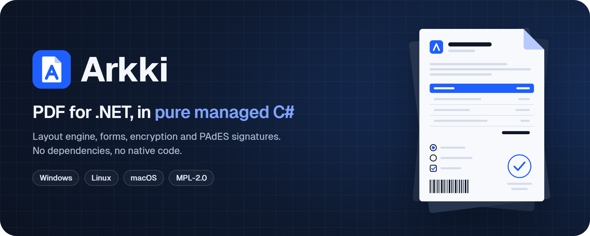

# Welcome to the Arkki wiki

Arkki is a PDF library for .NET, written in C#. It creates documents with a
paginating layout engine, opens and edits existing files, fills and creates
forms, encrypts, and signs.

- **Pure managed code.** No System.Drawing, no native binaries, no browser
  engine. It runs the same on Windows, Linux and macOS.
- **No dependencies** in the core package. Signing adds only Microsoft's
  `System.Security.Cryptography.Pkcs`.
- **Deterministic.** The same input gives the same bytes.
- **Open source** under the Mozilla Public License 2.0.

Arkki is Finnish for a sheet of paper.

## Start here

| | |
|---|---|
| [[Getting Started]] | Install the package and write your first PDF |
| [[Layout]] | Text, lists, tables, rows and columns that flow over pages |
| [[Forms]] | Read, fill and create text fields, check boxes, radio buttons, combo and list boxes |
| [[Editing and Merging]] | Open a file, stamp it, move its pages, merge, bookmark, attach |
| [[Encryption and Signing]] | AES-256 passwords and PAdES digital signatures |
| [[Fonts Images Barcodes]] | What goes on the page besides text |
| [[Troubleshooting]] | Exceptions and what they mean, threads, missing letters |
| [[FAQ]] | Licence, platforms, what is not included |

## The two packages

| Package | Contents |
|---|---|
| `Arkki.Pdf` | Writer, layout engine, TrueType/OpenType fonts, PNG/JPEG images, barcodes, reader, merging, page operations, stamping, forms, links, bookmarks, attachments, encryption |
| `Arkki.Pdf.Signing` | PAdES digital signatures (B-B, B-T with an RFC 3161 timestamp) and their verification |

Both require .NET 10.

## Elsewhere

- [Homepage](https://geezery.github.io/arkki/)
- [Source and README](https://github.com/geezery/arkki)
- [Arkki.Pdf on NuGet](https://www.nuget.org/packages/Arkki.Pdf)
- [Changelog](https://github.com/geezery/arkki/blob/main/CHANGELOG.md)
